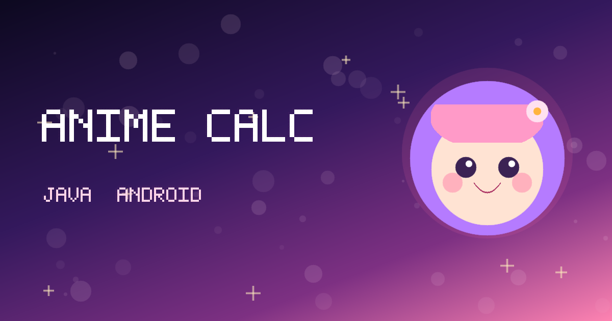
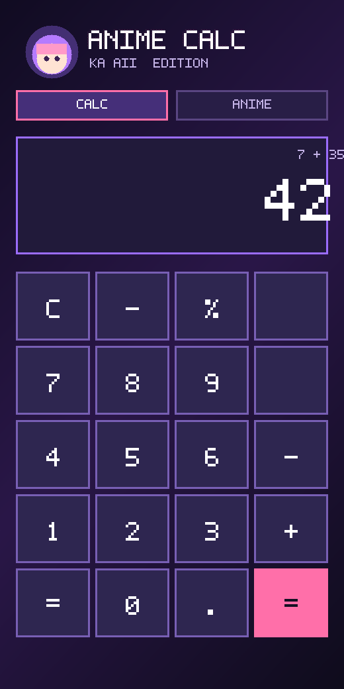
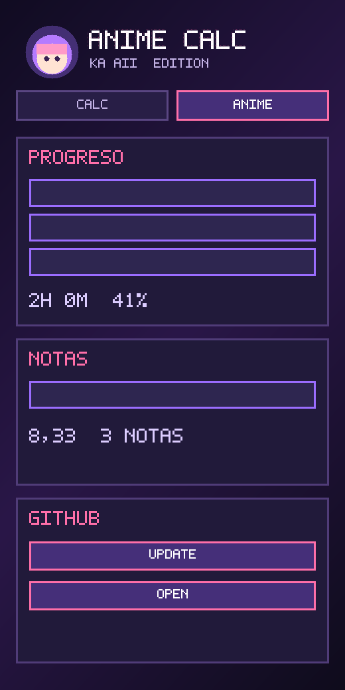

<div align="center">



# 🌸 Anime Calc

**La calculadora kawaii que todo fan de anime necesita.** Tres temas de color,
mascota propia, partículas flotantes y herramientas para tu maratón de series.

[](https://www.android.com/)
[](https://openjdk.org/)
[](https://github.com/KoalaSan/anime-calculator/releases)
[](https://github.com/KoalaSan/anime-calculator/releases)
[](LICENSE)
[](https://github.com/KoalaSan)

[Descargar APK](https://github.com/KoalaSan/anime-calculator/releases/latest) ·
[Instalación](docs/INSTALACION.md) ·
[Actualizaciones](docs/ACTUALIZACIONES.md) ·
[Diseño](docs/DISEÑO.md)

</div>

---

## ✨ Novedades de la v1.2

- 🎨 **Tres paletas**: Sakura (rosa), Hoshizora (azul) y Yoru (violeta). Cambia con el botón de la cabecera.
- 🌸 **Mascota original** dibujada como vector XML: pelo rosa, flor de sakura y su calculadora.
- ✨ **Fondo animado** con estrellas y pétalos que flotan suavemente.
- 🃏 **Tarjetas redondeadas**, botones con estado pulsado y tipografía jerarquizada.
- 🧩 **Icono propio** de launcher con calculadora y flor de sakura.

## 🧮 Calculadora

| ✅ Incluido | Detalle |
| --- | --- |
| Operaciones | `+` `−` `×` `÷` con encadenamiento correcto |
| Extras | decimal, signo `±`, porcentaje `%`, `C`, `⌫` e historial |
| Seguridad | aviso claro al dividir entre cero |
| Feedback | vibración suave y botones con estado pulsado |

## 🌸 Herramientas anime

- **📺 Progreso**: episodios totales, vistos y duración → tiempo visto, restante y `%`.
- **⭐ Notas**: promedio de varias notas con mensaje de ánimo según la puntuación.
- **🔄 Actualizaciones**: consulta GitHub Releases y ofrece descargar la versión nueva.
- **🌐 Acceso directo** a la página de descargas.

## 📷 Capturas

<div align="center">

| Calculadora | Herramientas anime |
| :---: | :---: |
|  |  |

</div>

## 📦 Datos técnicos

| Campo | Valor |
| --- | --- |
| Paquete | `com.buddyapps.anicalc` |
| Versión actual | 1.2 (versionCode 3) |
| SDK mínimo | 26 · Android 8.0 |
| Stack | Java 8 + Android framework, sin AndroidX ni Gradle |
| Tamaño APK | ~25 KB |
| Repositorio | KoalaSan/anime-calculator |

## 🗂 Estructura

```
assets/banner.png                       Imagen de cabecera / social preview
res/drawable/ic_launcher.xml            Icono vectorial de la app
res/drawable/mascot.xml                 Mascota vectorial
java/com/buddyapps/anicalc/MainActivity.java   UI, lógica y animación
tools/make_banner.py                    Generador del banner (PNG puro, sin librerías)
docs/INSTALACION.md                     Cómo compilar e instalar
docs/ACTUALIZACIONES.md                 Backup y actualizaciones
docs/DISEÑO.md                          Identidad visual y paletas
docs/VERIFICACION.md                    Pruebas en dispositivo
CHANGELOG.md                            Historial de versiones
backup.sh                               Guarda el APK y hace push a GitHub
```

## 🛠 Compilar

```bash
bash ~/.buddy/work/.claude/skills/android-app/setup-toolchain.sh   # solo la primera vez
bash ~/.buddy/work/.claude/skills/android-app/build-apk.sh ~/.buddy/work/anime-calculator
```

El APK queda en `build/app.apk`. Cada cambio de versión debe subir `versionCode`
y ejecutarse `bash backup.sh` para subirlo todo a GitHub.

---

<div align="center">Hecho con ♥ y sakura 🌸 para la comunidad anime.</div>
